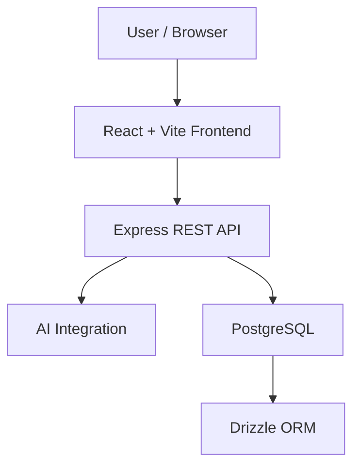

# ⚖️ DraftMate Legal Studio

<div align="center">

### The Future of Legal Drafting Is Intelligent

**An AI-powered workspace for drafting, reviewing, and refining legal documents.**

[](https://draft-mate-legal-studio--draftmate.replit.app)
[](https://react.dev/)
[](https://www.typescriptlang.org/)
[](https://nodejs.org/)

### [🚀 Launch Live Application](https://draft-mate-legal-studio--draftmate.replit.app)

</div>

---

## ✨ About the Project

**DraftMate Legal Studio** is a modern AI-powered legal-tech workspace built to simplify legal drafting and document workflows.

The platform brings together a responsive interface, AI-assisted writing capabilities, and a structured backend architecture to support more efficient legal document preparation and review.

> **Our vision:** Make legal document workflows smarter, faster, and more accessible while keeping human judgment at the center.

## 💎 Key Features

| Feature | Description |
|:---|:---|
| 🤖 AI-Assisted Drafting | Generate and refine legal text |
| 📑 Document Workspace | Organize and work with legal drafts |
| 🔍 Contract Review | Support document and clause analysis |
| ✍️ Content Refinement | Improve clarity, tone, and structure |
| 🎨 Modern UI | Responsive legal-tech interface |
| ⚡ API Architecture | Separate frontend and backend services |

## 🏗️ Architecture



## 🛠️ Technology Stack

| Layer | Technology |
|:---|:---|
| Frontend | React, TypeScript, Vite |
| Backend | Node.js, Express |
| Database | PostgreSQL |
| ORM | Drizzle |
| Package Manager | pnpm |
| AI Integration | OpenAI API |
| Live Hosting | Replit |

## 📂 Project Structure

```text
DraftMate-Legal-Studio/
├── artifacts/
│   ├── draftmate-studio/    # Frontend
│   └── api-server/          # Backend
├── lib/
│   └── db/                  # Database
├── package.json
├── pnpm-workspace.yaml
└── README.md
```

## 🚀 Getting Started

**1. Clone the repository**

```bash
git clone https://github.com/Madhuri-Kumari2504/DraftMate-Legal-Studio.git
cd DraftMate-Legal-Studio
```

**2. Install dependencies**

```bash
pnpm install
```

**3. Configure backend environment**

```env
DATABASE_URL=your_postgresql_connection_string
OPENAI_API_KEY=your_openai_api_key
PORT=8000
```

Keep real secrets out of Git.

**4. Initialize database**

```bash
pnpm --filter @workspace/db run push
```

**5. Build and start backend**

```bash
pnpm --filter @workspace/api-server run build
pnpm --filter @workspace/api-server run start
```

**6. Run frontend**

Configure the frontend environment and API base URL, then run:

```bash
pnpm --filter @workspace/draftmate-studio run dev
```

## 🌐 Live Demo

### [🚀 Open DraftMate Legal Studio](https://draft-mate-legal-studio--draftmate.replit.app)

Experience the live application.

## 🗺️ Future Roadmap

- [ ] Advanced clause comparison
- [ ] Automated legal risk scoring
- [ ] Document version history
- [ ] Secure cloud document storage
- [ ] Team collaboration
- [ ] Enhanced document export

*These are planned improvements rather than currently verified features.*

## 🔐 Security & Privacy

Legal documents may contain confidential information. Production deployments should implement secure authentication, authorization, encrypted transport, and appropriate data-retention controls.

Never expose API keys or database credentials in frontend code.

## ⚖️ Disclaimer

DraftMate Legal Studio is an assistance tool, not a substitute for professional legal advice. AI-generated content must be reviewed by a qualified legal professional before use.

---

<div align="center">

### ⚖️ DraftMate Legal Studio

**Draft Smarter. Review Faster. Work Confidently.**

[🌐 Live Application](https://draft-mate-legal-studio--draftmate.replit.app) · [💻 GitHub](https://github.com/Madhuri-Kumari2504/DraftMate-Legal-Studio)

Made with ❤️ for the future of legal technology.

</div>
