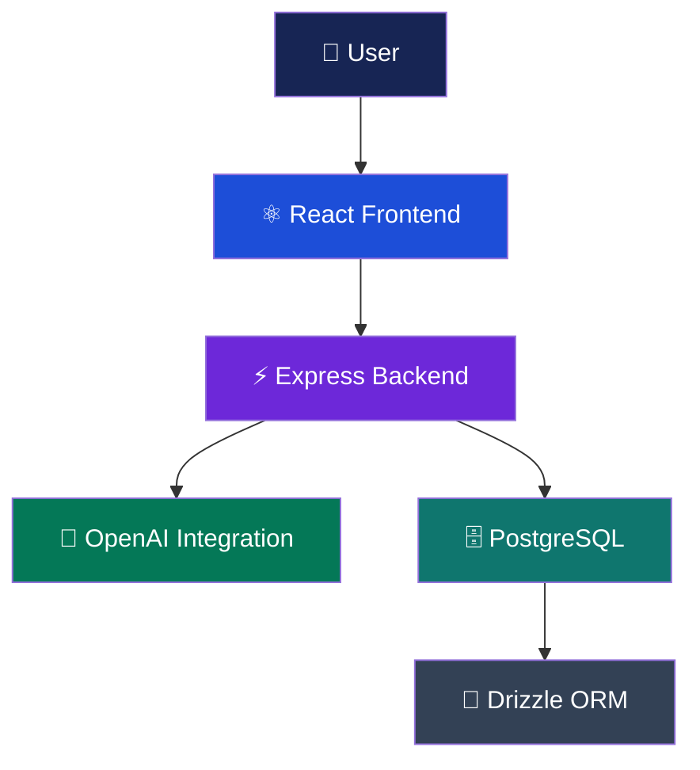

<div align="center">

# ⚖️ DraftMate Legal Studio

### ✨ Intelligent Legal Drafting, Reimagined

**An AI-powered legal workspace for smarter drafting, faster reviews, and efficient document management.**

<br>

[](https://draft-mate-legal-studio--draftmate.replit.app)
[](#-meet-team-codex)
[](#-project-roadmap)

<br>

### 🌐 [Explore the Live Application](https://draft-mate-legal-studio--draftmate.replit.app)

**Built with innovation and passion by Team codeX**

</div>

---

## 🌟 About DraftMate

> **"Draft Smarter. Review Faster. Work Confidently."**

**DraftMate Legal Studio** is an AI-powered legal technology platform designed to simplify document drafting, contract analysis, and legal content refinement.

Our goal is to bridge the gap between complex legal workflows and modern artificial intelligence through an intuitive, accessible digital workspace.

### 🎯 Our Mission

To empower legal professionals, students, and organizations with intelligent tools that help reduce repetitive drafting work and improve productivity while preserving human oversight.

---

## 💎 Core Features

| Feature | Description |
|:---|:---|
| 🤖 **AI-Powered Drafting** | Generate and refine legal text using artificial intelligence |
| 📄 **Legal Document Workspace** | Work with legal drafts in an organized interface |
| 🔍 **Contract Review** | Assist with reviewing contracts and legal clauses |
| ✍️ **Smart Refinement** | Improve clarity, structure, and tone |
| 🎨 **Modern Dashboard** | Responsive, user-friendly legal workspace |
| ⚡ **Backend API** | Express-based API architecture |
| 🧠 **AI Integration** | OpenAI-powered legal assistance |

---

## 🛠️ Technology Stack

<div align="center">


</div>

| Component | Technology |
|:---|:---|
| **Frontend** | React, TypeScript, Vite |
| **Backend** | Node.js, Express |
| **Database** | PostgreSQL |
| **ORM** | Drizzle ORM |
| **AI Engine** | OpenAI API |
| **Package Manager** | pnpm |
| **Deployment** | Replit |

---

## 🏗️ System Architecture



---

## 📂 Project Structure

```text
DraftMate-Legal-Studio/
│
├── artifacts/
│   ├── draftmate-studio/      # React Frontend
│   └── api-server/            # Express Backend
│
├── lib/
│   └── db/                    # Database Configuration
│
├── package.json
├── pnpm-workspace.yaml
└── README.md
```

---

## 🚀 Getting Started

### 1️⃣ Clone the Repository

```bash
git clone https://github.com/Madhuri-Kumari2504/DraftMate-Legal-Studio.git
cd DraftMate-Legal-Studio
```

### 2️⃣ Install Dependencies

Ensure Node.js and pnpm are installed.

```bash
pnpm install
```

### 3️⃣ Configure Environment Variables

Set the following server-side environment variables:

```env
DATABASE_URL=your_postgresql_connection_string
OPENAI_API_KEY=your_openai_api_key
PORT=8000
```

Never commit actual API keys or passwords to GitHub.

### 4️⃣ Initialize Database

```bash
pnpm --filter @workspace/db run push
```

### 5️⃣ Start Backend

```bash
pnpm --filter @workspace/api-server run build
pnpm --filter @workspace/api-server run start
```

### 6️⃣ Start Frontend

Configure the frontend API URL and required Vite environment variables.

```bash
pnpm --filter @workspace/draftmate-studio run dev
```

---

## 🌐 Live Application

<div align="center">

### 🚀 Experience DraftMate Legal Studio

**AI-powered legal drafting at your fingertips.**

[](https://draft-mate-legal-studio--draftmate.replit.app)

**Website:** https://draft-mate-legal-studio--draftmate.replit.app

</div>

---

## 👨‍💻 Meet Team codeX

<div align="center">

### 💜 The Minds Behind DraftMate

**Team codeX**

*Building innovative technology solutions through collaboration, creativity, and engineering.*

</div>

| Role | Name | Responsibility |
|:---|:---|:---|
| 👑 **Team Leader** | **Alka Kumari** | Team leadership, coordination, and project direction |
| 💻 **Development Team** | **Team codeX** | Application development, integration, and improvements |

### 🌟 Our Team Philosophy

> **"Think Bold. Build Smart. Code Beyond Limits."**

At **codeX**, we believe meaningful innovation comes from combining technical expertise, creativity, teamwork, and real-world problem-solving.

DraftMate Legal Studio reflects our commitment to developing intelligent solutions that make professional workflows more efficient and accessible.

---

## 🗺️ Project Roadmap

- [ ] Advanced AI-powered clause comparison
- [ ] Automated legal risk assessment
- [ ] Secure cloud document storage
- [ ] Document version control
- [ ] Multi-user collaboration
- [ ] Enhanced document export
- [ ] Expanded legal document templates
- [ ] Role-based access controls

*Roadmap items represent planned enhancements, not existing functionality.*

---

## 🔐 Security & Privacy

Legal documents may contain confidential information.

Production deployments should include:

- Secure authentication and authorization
- Encrypted communication
- Appropriate data protection and retention
- Secure API key management
- Access controls for sensitive documents

---

## ⚖️ Legal Disclaimer

DraftMate Legal Studio is an AI-assisted software platform and does not provide professional legal advice.

AI-generated or AI-reviewed documents may contain inaccuracies. Users should consult qualified legal professionals before relying on generated content for legal matters.

---

## 🤝 Contributing

We welcome ideas, improvements, and constructive feedback.

1. Fork the repository.
2. Create a feature branch.
3. Make your changes.
4. Submit a pull request.

---

<div align="center">

## 💜 Crafted by Team codeX

### 👑 Led by Alka Kumari

**Innovation • Collaboration • Technology**

<br>

[](https://github.com/Madhuri-Kumari2504/DraftMate-Legal-Studio)
[](https://draft-mate-legal-studio--draftmate.replit.app)

### ⚖️ DraftMate Legal Studio

**Draft Smarter. Review Faster. Work Confidently.**

Made with ❤️ by **Team codeX**

⭐ **Star this repository if you like our project!**

</div>
